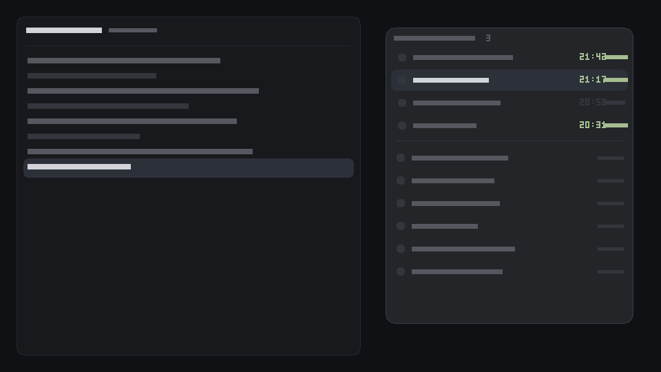

# rename-history

Herdr's terminal right-click menu with one addition: a **RENAME HISTORY**
section listing the `/rename` titles the terminal has seen, newest first.
Pick one and the terminal scrolls back to that rename's report — or, when the
end of the turn was not caught, to the prompt line that started it. Works
with the omo agent's terminals (see Limits).



## What it does

- The usual right-click menu (Rename, Split, Zoom, Close, worktrees, themes —
  everything the shipped `menu` has), plus a RENAME HISTORY section when the
  terminal has history: each row shows a bookmark icon, the title and the
  time, with `report` or `prompt` saying where a jump lands. More than 12
  bookmarks are summarized as "+N older"; 50 are kept per terminal.
- Jumping locates the title by text anchors in the scrollback (one `hc read`
  at jump time), so it survives reflow. When the position is gone, a dialog
  shows the terminal's tail instead.
- Works on Shift+right-click too (when a program takes the mouse and plain
  right-click goes to it).

## Install — two parts

**1. The mod**

```sh
cp -r rename-history ~/.config/herdr-app/mods/
herdr-app check ~/.config/herdr-app/mods/rename-history
```

Then use it as your terminal menu. Herdr's shipped layouts are read-only, so
clone yours first and edit the clone:

```sh
herdr-app do layout.clone '{"name":"main","as":"my-main"}'
```

In `~/.config/herdr-app/layouts/my-main.json`, add at the root (next to
`"type"` / `"children"`):

```json
"terminal_menu": "rename-history"
```

If the menu was already open in a session started before the folder existed,
restart Herdr so the new mod is loaded.

**2. The omo extension** (records the history; skip it and the menu simply
has no history section)

```sh
cp -r rename-history/omo-extension ~/.omo/agent/extensions/herdr-rename-history
```

Restart omo (each omo records the titles of its own terminal into
`~/.config/herdr-app/data/rename-history/<address>.json`; nothing is polled).

## Usage

Right-click a terminal (Shift+right-click when the program takes the mouse):
the RENAME HISTORY section sits above the usual items. Click or ↑/↓ + Enter a
title to jump; Esc closes. Everything else in the menu works as before.

## Limits

- The history is recorded by an **omo extension** — terminals running other
  agents or plain shells get the plain menu without the section.
- A rename whose turn was too short to capture lands on the **prompt** line
  rather than a report.
- The menu shows the **12** most recent titles; **50** are kept per terminal.
- Remote terminals (another machine) are not supported.

## Privacy & reach

The extension writes one small JSON file per omo terminal under Herdr's
`data/` folder and runs `hc ls` / `hc get` to find which terminal it is in.
The mod reads those files (`readTextFile`), runs `git` for the menu's
worktree items (as the shipped menu does) and one `hc read` on jump. Nothing
leaves the machine.

## Credits

Built on Herdr's shipped `menu` mod (Apache-2.0) — see `NOTICE`.
`RECIPE.md` is the build brief.
