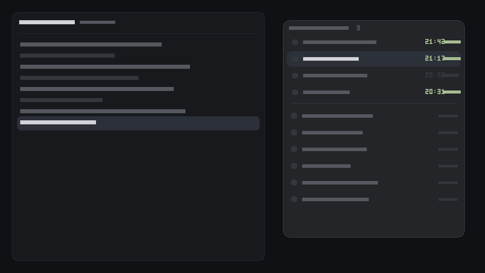

# rename-history

The terminal right-click menu, with a RENAME HISTORY section: every /rename
title this omo terminal has seen, newest first, each row jumping the terminal
back to that rename's report (or its prompt line when the turn's end was not
caught). Two parts build it: a Herdr mod (the menu itself) and an omo
extension that records the titles.

**What you see:** the context menu Herdr ships — a popover (`t.popover`
background, 12.8px text, 31px rows, 7px rounding, an icon at 14px in muted, a
label, the key hint at 11px dim on the right, separators before Close /
Keybinds and around theme groups) — with, above the pane items, a 10.5px dim
"RENAME HISTORY" header (+"· +N older" when more exist) and one 31px row per
bookmark: a 13px bookmark icon (the mod's own `bookmark.svg`), the title
truncated in the middle, and on the right a 11px "HH:MM · report" (done color)
or "HH:MM · prompt" (dim). Arrow keys move the highlight, Enter runs, Esc
closes. When a jump's position is gone, a 640x420 dialog shows the title, a
note, and the terminal's last 40 lines in a scrolling list.

**How it behaves:** right-click on a terminal opens it at the pointer with
props {tab: "pane", target: {pane, terminal}} (Shift+right-click when the
program owns the mouse); tab, space and global right-clicks render the same
sections as the shipped menu. The history section appears once the extension
has recorded a title: picking a row focuses the terminal, runs one `hc read
<address> --lines 400`, locates the bookmark's report anchor (its last lines,
exact run first, then prefixes) and scrolls there via `terminal.scroll`;
falling back to the prompt anchor, and to the snippet dialog when neither is
in the scrollback. While the menu is open it refreshes itself through a
`watchFolder` on Herdr's data folder. Agent status does not appear here;
the menu is the same for every status.

**Built from:** (a) the mod `mods/rename-history/`: `main.js` — a clone of
the shipped `menu` mod (its `items(p, git)` switch over props.tab with the
pane/tab/space/global sections, `menuIcon` naming icons in the shipped
`workspace-chrome` folder, `shortcut` reading `keys()`, the git checkout
probing for worktree items) plus: a `RENAME HISTORY` header, up to 12
`{rh: bookmark}` rows above the items, a "+N older" count, and a jump that
closes the overlay only after `jump()` resolves; `tracker.js` —
`ensure(address)` reads `~/.config/herdr-app/data/rename-history/<encoded
address>.json` ({v, address, items}), `watch(cx, addr)` re-reads on folder
changes, `jump()` does the anchor search and `terminal.scroll`;
`mod.json` { "place": "none", "overlay": { "width": 300, "height": 0.8 } }.
(b) the omo extension `omo-extension/index.ts`: on
`session_info_changed` push {title (max 80 chars), ts}; on user
`message_end` attach up to 3 prompt anchor lines (prefix 60 chars, lines
under 4 chars dropped); on `turn_end` attach report anchors the same way
from the tail; on `session_start` reason "new" delete the file; one JSON
file per terminal (single writer, temp file + atomic rename, bounded to 50
items), address resolved once by matching `hc get` foreground pid against
the process pid, dead terminals' files swept on load. herdr functions:
`props`, `run` (pane.focus, terminal.scroll, the menu's own commands),
`openOverlay`/`closeOverlay`, `theme`, `keys`, `terminals`, `spaces`,
`panes`, `exec` (git), `hc` (read), `readTextFile`, `watchFolder`,
`appHome`. Programs run: git (menu items), hc read (jump). Art: the mod's
own `bookmark.svg`; all other icons come from the installed
`workspace-chrome` mod at run time.

**Watch out:** the menu mod must actually be loaded — a mod folder created
while Herdr is running is not hot-reloaded (restart Herdr, or the menu stays
an older copy); `mod.json`'s overlay height 0.8 (a share of the window)
keeps the 12-row history plus the base items on screen; the popup is
content-sized, so cap the shown rows (MAX_SHOWN 12) or the base items fall
off; anchors are line prefixes, not row numbers, because the scrollback
reflows; /rename is seen through `session_info_changed`, which carries no
cause, so titles set by the agent itself are recorded too (known limit);
remote addresses contain "/" and are percent-encoded into file names; the
extension must never write to the session screen — every handler is guarded
and silent. Assumes Herdr 0.1.x with terminal_menu layouts support and omo
5.1.x extension events.

**Done when:** `herdr-app check` on the mod folder passes; with
`"terminal_menu": "rename-history"` in a personal layout and Herdr
restarted, a right-click shows the usual items plus RENAME HISTORY once the
extension has recorded a title; picking an old title scrolls the terminal to
its report (or shows the tail dialog when the position is gone); "+N older"
appears beyond 12 bookmarks and 50 are kept; a plain right-click on a shell
terminal shows the menu without the section; Esc closes.
