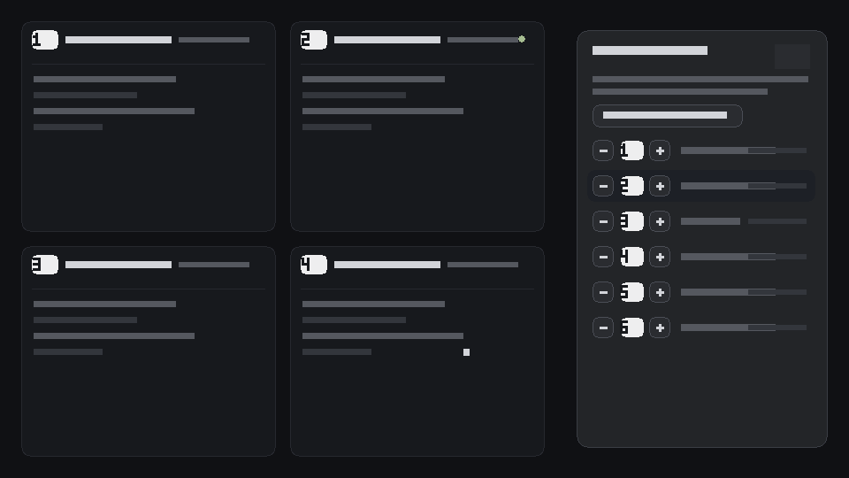

# terminal-numbers

Every terminal gets a **big, sticky number** in its pane header, so you can
say "terminal 3" instead of describing where it sits. Click a number to open
a small manager: step a number up or down (a taken number swaps with its
owner), or renumber everything by screen order. The number-to-terminal map is
also written where outside tools can read it — a voice assistant or agent
with file access can answer "which one is 5?".



## What it does

- **Numbers on pane headers**: a bright tile with a bold number at the left of
  each terminal's header. The rest of the header (program icon, title,
  folder, status, split/zoom/close buttons) is unchanged from Herdr's
  shipped `pane` header.
- **Sticky numbers**: rearranging, zooming or moving panes never renumbers.
  A new terminal takes the smallest free number; a closed terminal frees its
  number (a parked one keeps it while it lives).
- **A manager popup**: click any number tile. Each row has `-` / `+` (a taken
  number swaps with its owner) and a tooltip with the terminal's address.
  "Renumber by position" renumbers 1..N in the layout's reading order
  (columns left to right, each top to bottom).
- **First-run seed**: with no numbers yet, the mod adopts `seed.json` in its
  own folder if present (see `seed.example.json`; `{}` starts from layout
  order), else any `herdr.num` labels, else the layout order.
- **Outside the app**: the map is exported to `numbers.json` in this mod's
  folder ({number: terminal address}, plus titles and folders), and every
  terminal carries its number as the `herdr.num` label, which
  `hc get <address>` shows.

## Install

```sh
cp -r terminal-numbers ~/.config/herdr-app/mods/
herdr-app check ~/.config/herdr-app/mods/terminal-numbers
```

Then point a personal layout's pane header at it. Herdr's shipped layouts are
read-only, so clone yours first and edit the clone:

```sh
herdr-app do layout.clone '{"name":"main","as":"my-main"}'
```

In `~/.config/herdr-app/layouts/my-main.json`, find the tab block's pane
header and change `"mod": "pane"` to `"mod": "terminal-numbers"`:

```json
"content": { "tab": "active", "pane": { "header": { "content": { "mod": "terminal-numbers" } } } }
```

The window follows within a second; `herdr-app status` should show no errors.

Optional: copy `seed.example.json` to `seed.json` and fill in
{`<terminal address>`: number} to pin your current numbers before the first
run (delete it any time; it is only read when no numbers exist yet).

## Privacy & reach

The mod runs `hc label <address> herdr.num=<n>` on your local herdr-core
(it labels terminals; it does not read or send anything), and writes
`numbers.json` inside its own folder. It touches nothing else.

## Credits

The header is built on Herdr's shipped `pane` header mod and reuses its
icons (Apache-2.0) — see `NOTICE`. `RECIPE.md` is the build brief.
