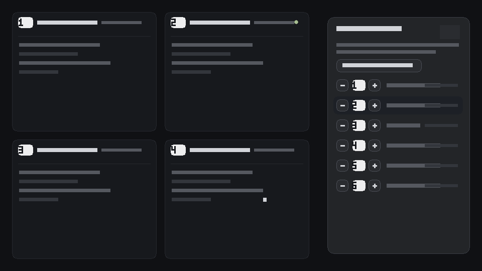

# terminal-numbers

Every terminal in the window gets a big, sticky number on its pane header — a
bright rounded tile with a bold number where the header begins — so a person
(or a voice assistant) can say "terminal 3" and mean one specific terminal.
Clicking a tile opens a small manager popup (Korean copy) where each number
can be stepped up or down, swapped, or the whole grid renumbered by screen
order; the number-to-terminal map is exported to `numbers.json` and to
`herdr.num` labels for tools outside the app.

**What you see:** a pane header exactly like Herdr's shipped `pane` header —
30px tall, the terminal's background color, a hairline border under it — with
one addition at the left edge: a 26x20 rounded tile in the theme's `solid`
color holding a 15px bold number in `solid_foreground`. After the tile come
the usual pieces: the program icon (14px), the agent name or terminal title
(12px, medium, truncated at 260px), the folder (dim, fills the remaining
width), the status marks (a spinning 12px icon while working, a
"Needs you" pill when blocked, a 7px dot when done), and, on hover, the
split-right / split-down / zoom / close icon buttons. The manager popup
(400px wide) lists every numbered terminal as a 30px row: a bordered 26x24
`-` button, the number tile, a bordered `+` button, the terminal's title, and
its folder dimmed on the right; above the list a 14px semibold title
("Terminal numbers"), two 12px guide lines, a bordered "Renumber by position"
button and a "Close" button at the top right; a dim footer names
`numbers.json` and the label.

**How it behaves:** numbers never change on their own when panes move, split,
zoom or get dragged — the map is sticky, keyed by terminal address. A new
pane terminal takes the smallest free number; when a terminal closes its
number frees; a parked terminal keeps its number while it lives. Clicking a
number tile (pointer cursor, slight fade on hover; a tooltip "Terminal
number — click to manage numbers") opens the manager as a popup at the pointer, the
clicked terminal's row highlighted; clicking the header elsewhere focuses the
pane, as before. In the manager, `-` / `+` step that row's number by one and
**swap** with whoever owned the target number (each button explains itself in
a tooltip, and each row's tile shows the terminal's address in its tooltip);
"Renumber by position" reassigns 1..N in `panes()` order — the layout tree's reading
order, columns left to right, each top to bottom — dropping numbers of
paneless (parked) terminals; "Close" and Esc close. Agent status marks work
exactly as the shipped header: working spins, blocked shows the pill, done
shows the dot; nothing of it moves the number. On first run with no numbers,
`seed.json` in the mod folder is adopted if present, else any `herdr.num`
labels on live terminals, else the layout order.

**Built from:** one mod folder `mods/terminal-numbers/` with `main.js`,
`mod.json` ({ "place": "none", "title": "Terminal numbers", "overlay": {
"width": 400, "height": 620 } }) and six small SVGs. The default export is
one `View` with two faces chosen by `props()`: `props().pane` set means a
pane-header copy (one per pane, drawn by the layout's tab block:
`{ "tab": "active", "pane": { "header": { "content": { "mod":
"terminal-numbers" }, "reveal": "always", "height": 30, "position": "top" } } }`);
otherwise the manager. The header face is the shipped `pane` header's code
(`paneFrame(layout())` for the header position, the program-table icon,
`folder()` shortening, status marks, hover buttons) plus the number tile.
Module-scope state: `shared("terminal-numbers.map")` (address to number) via
`shared`/`setShared`; `ensure()` prunes closed terminals and assigns smallest
free numbers in `panes()` order; `boot(cx)` gates auto-assignment until the
first-run seed (`readTextFile` of `seed.json`, guarded by `checking()`) has
been tried once, so layout-order numbers never flash before a seed lands;
`maybePersist(cx)` runs only when the serialized map changed (and never under
`checking()`): it writes `numbers.json` (read-modify-write through
`readTextFile` + `writeTextFile` with an expected snapshot, one retry) and
sets `hc(["label", addr, "herdr.num=" + n])` per changed terminal, best
effort. Commands used: `pane.focus`, `pane.split`, `pane.zoom`,
`pane.close` (the header's own buttons), `openOverlay`/`closeOverlay` for
the manager, `hc label` on the local core. Art: the six SVGs are copied from
Herdr's shipped `pane` and `workspace-chrome` mods (Apache-2.0; see NOTICE).
No `keys.json`, no network, no other programs.

**Watch out:** (1) The manager's row list must carry its own height —
`flex_1().min_h(0)` collapses to zero in a popup's unbounded height pass and
the rows vanish; give the list a fixed height (rows x 32 + 6, capped at 12
rows with `overflow_y_scrollbar()`) and the root a fixed width. (2) The
tile's `openOverlay` must pass `width` and `height` itself; `kind: "popup"`
sizes to content otherwise. (3) Draw the glyph container like the number tile
(`div().flex().items_center().justify_center()`); a fixed-width `h_flex`
child dropped the `-` / `+` glyphs entirely in one build. (4) Only this
machine's terminals are numbered: addresses with a `/` (other machines) are
skipped, because `hc label` would run on the wrong core. (5) UI copy is
Korean by design. (6) Hot reload occasionally misses a save; rewriting the
file (or switching layouts away and back) re-applies it. Assumes Herdr 0.1.x
with `panes()`, `terminals()`, shared state and overlays as in
`herdr.d.ts`.

**Done when:** `herdr-app check` on the mod folder passes; with the layout's
pane header pointed at it, `herdr-app status` shows no errors and every
terminal's header shows its tile; clicking a tile opens a 400px-wide manager
whose rows all show `-`, a number tile and `+` (hover any of them for its
tooltip); stepping a number over an occupied one swaps the two;
`mods/terminal-numbers/numbers.json` appears and matches the tiles;
`hc get <address>` shows `herdr.num` equal to the tile; a brand-new terminal
gets the smallest free number and closing it frees the number.
